# Hundehuse

Spillet hundehuse handler om at den blå hund gerne vil købe et nyt hundehus, fordi dens nuværende hus er hullet i taget og for lille. der er lidt forhindringer når den skal over vejen.

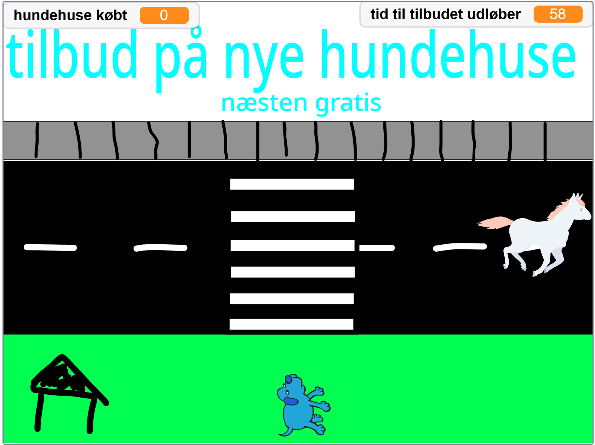

## Baggrund

Du kan selv bestemme hvordan den ser ud. Jeg har tegnet den sådan her.

## Hunden

Hunden skal gå over fodgængerovergangen og købe et nyt hundehus. Den kan kun gå lige ud og tilbage.

### Hundens kostumer

Man kan bare søge på "dog" og fjerne det sidste kostume hvor den ser undrende ud.

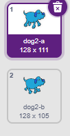

### Hundens kode så den kan gå

Det ser ud som om at den går når den skifter kostumerne.

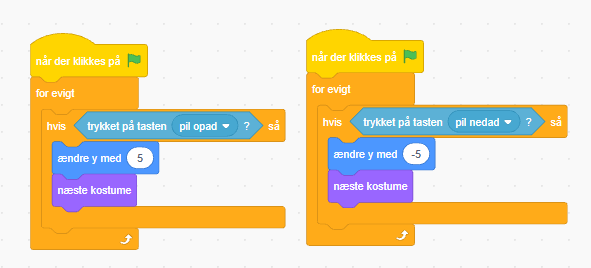

### Lav to variabler

### Så den køber huse

Brug pipetten til at lave den samme farve som skiltet hvor der står: Tilbud på nye hundehuse.

### Lav en enhjørning og stop hunden hvis den rør den

Koden så den stopper hvis den berører enhjørningen.

## Enhjørningen

Den skal løbe hen af vejen.
Den har ikke så meget kode det er mest kostumer.

### Enhjørningens kostumer

Enhjørningen har mange kostumer, fordi at så ser det mere realistisk ud når den løber.

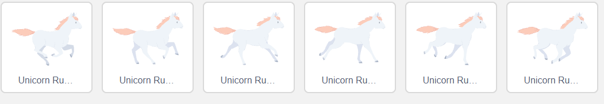

### Kode så den løber (og kommer igen)

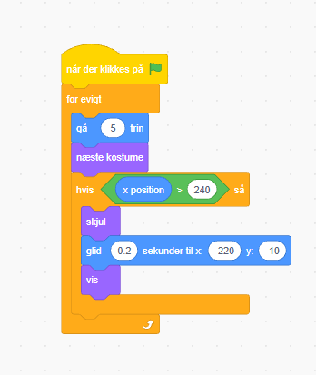

## Hundehuset

Det bliver bedre for jo flere huse du køber jo bedre bliver dit hus

## Hundehusets kostumer

### Dårligt hus

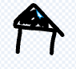

### Lidt bedre hus

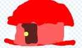

### Luksus hus

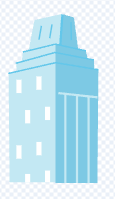

### Kode til hundehus

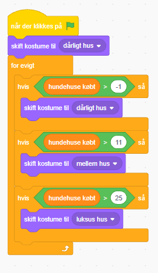

## Den sidste sprite er et slut billide

Du kan selv vælge farver og hvad der skal stå.

### fx

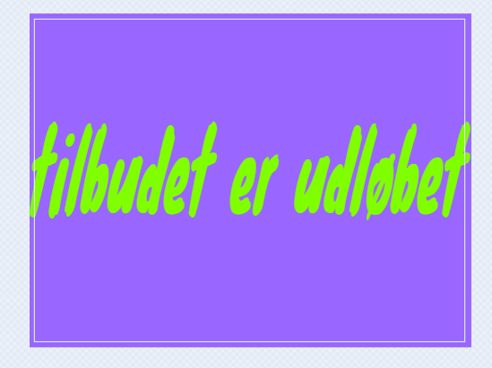

### Koden til slut billide som også indgår tiden

Den tæller ned fra 1 minut og når det er gået stopper den det hele.

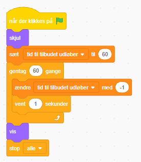

## 🥳 færdig 🥳

### Ekstra opgave 1 (mellem)

Prøv at få enhjørningen til at løbe hurtigerere og hurtigerere jo flere hundehuse du køber.

### Ekstra opgave 2 (svært at gennemføre banen)

Lav flere forhindriner FX tacoer, biler, kyllinger eller dinosaurer.
