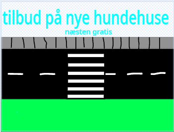
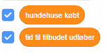
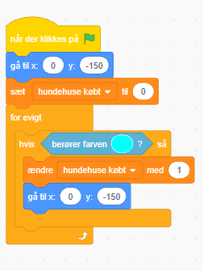
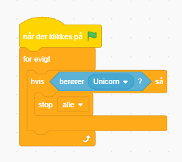

# Hundehuse

spillet hundehuse handler om at den blå hund gerne vil købe et nyt hundehus fordi at dens nuværende hus er hullet i taget og for lille. der er lidt forhindringer når den skal over vejen

## baggrund
du kan selv bestemme hvordan den ser ud jeg har tegnet den sådan her

## hunden 
hunden skal gå over fodgængerovergangen og købe et nyt hundehus. den kan kun gå lige ud og tilbage

### kotumer til hund
man kan bare søge på dog og fjerne det sidste kostume hvor den ser undrende ud

### hundens kode så den kan gå
Det ser ud som om at den går når den skifter kostumerne

### lav to variabler

### så den køber huse
brug pipetten til at lave den samme farve som skiltet hvor der står: tilbud på nye hundehuse

### lav en enhjørning og stop hunden hvis den rør den
koden så den stopper hvis den berører enhjørningen

## enhjørningen
den skal løbe hen af vejen

### kostumer
